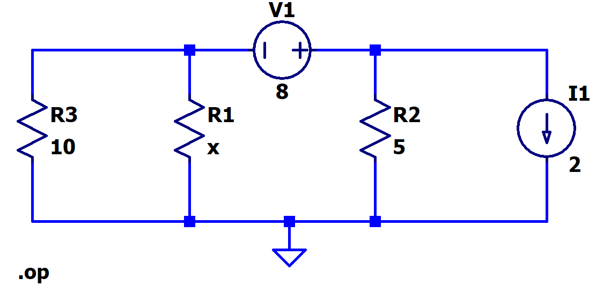

[← Back to overview](README.md)

# Problem 2. Nodal Analysis

## Task

In LTSpice, build this circuit with resistors.

Set the **R1** values, based on the **x**  on the [README page](README.md)

--------
Run the DC operating points Analysis ("Analysis" -> "DC op pnt"). 

A pop-out window will show the analysis report as a list. This report lists all distinct nodes except Ground.

To identify which node corresponds to which location in your circuit:

1. Go back to your circuit schematic.
2. Hover your mouse cursor over each node.
3. At the bottom of the LTspice window, a text line will show, such as "This is node n001".

-----

## :orange: Required in your homework answer

1. Include a screenshot of your circuit schematic.

2. Include a LTSpice report of the DC operating point analysis. (*direct paste the list result*)

3. Provide a detailed, step-by-step nodal analysis to this circuit. You should write it as detailed as the instructor showed in class. (step 1...step 2... step 3...).
     Note such circuit requires you to use **supernode** in analysis.
     You are expected the get the same final results as the simulation.

   *(You may write the calculation by hand, take a clear photo, and insert the photo into the same document that you work on.)*

