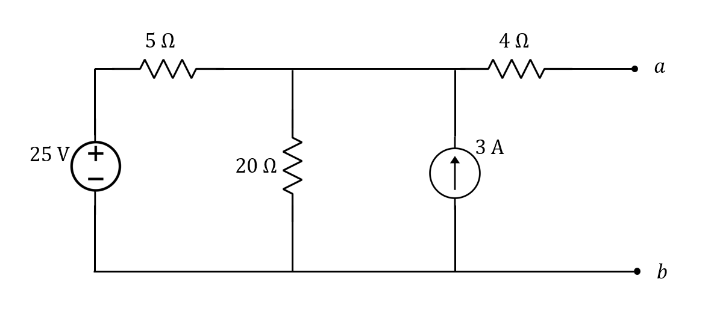
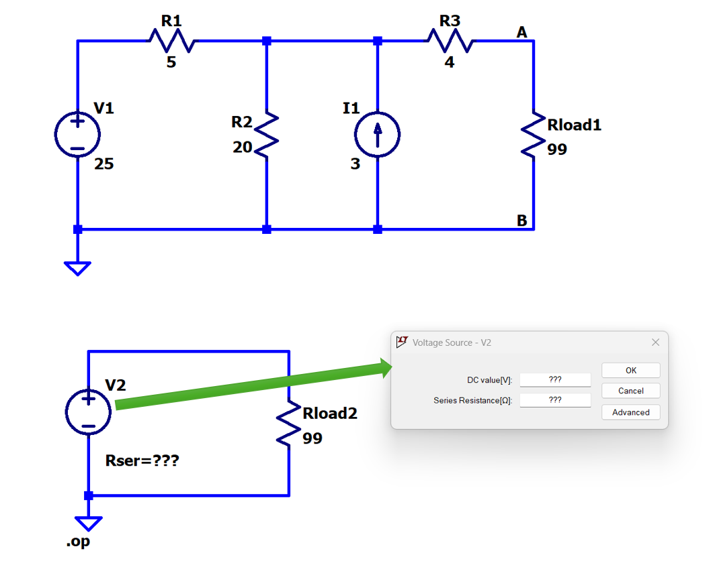

[← Back to overview](README.md)

# Problem 3. Thevenin

## Task

First, for this circuit, find its Thevenin equivalent circuit at terminals (a,b)

Obtain $V_{Th}$ and $R_{Th}$. You need to show your detailed calculation by hand.

-------

Second, In LTSpice, build this circuit with resistors.

- [ ] Top one is the original circuit with a large load $R_{load1} =99 \Omega$
- [ ] Bottom one is the equivalent one with the same load $R_{load2} =99 \Omega$
- [ ] For the bottom one, you will right click voltage source **V2**, set it as the green arrow indicated.
  * The DC value of **V2** will be your caulcated $V_{Th}$.
  * The series resistance of **V2** will be your calculated $R_{Th}$.
- [ ] Run the DC operating points Analysis ("Analysis" -> "DC op pnt").
- [ ] In the pop-out analysis, you should get the same current thru $R_{load1}$ and $R_{load2}$.

-----

## :orange: Required in your homework answer

1. Provide a detailed, step-by-step calculation for $V_{Th}$ and $R_{Th}$ of the Thevenin equivalent circuit.
2. Include a screenshot of your circuit schematic.
3. Include a LTSpice report of the DC operating point analysis. (*direct paste the list result*)

   *(You may write the calculation by hand, take a clear photo, and insert the photo into the same document that you work on.)*

