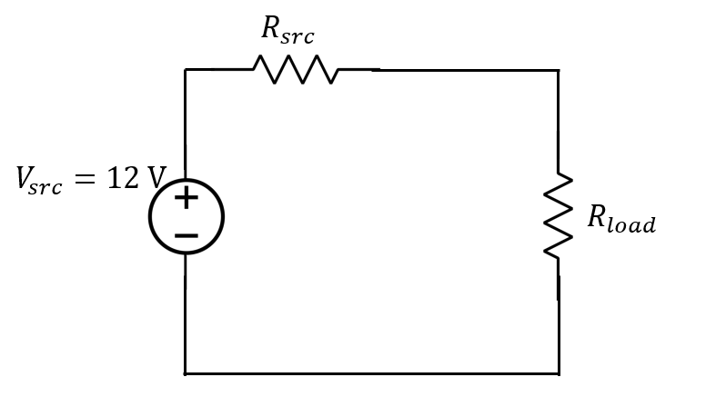
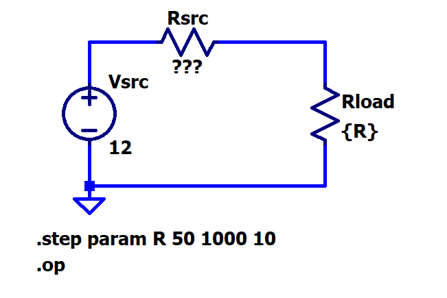
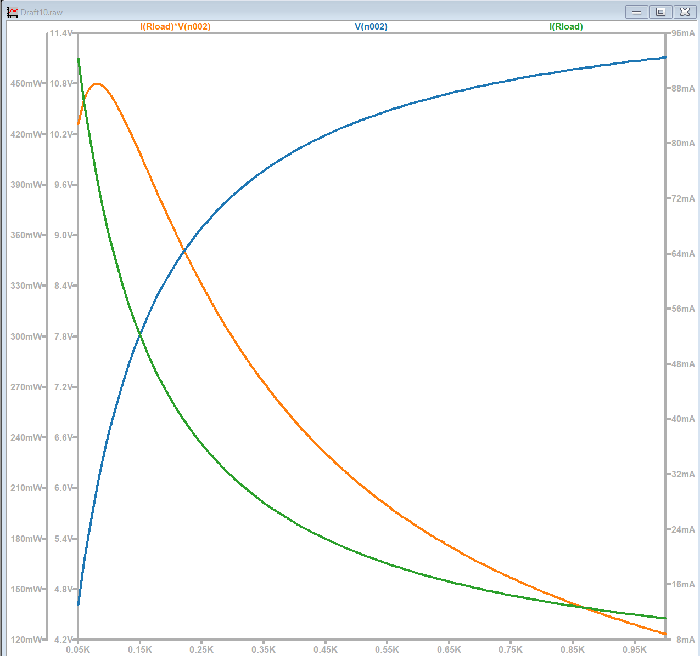

[← Back to overview](README.md)

# Problem 4. Max Power Transfer

## Task

We will study the Maximum Power Transfer of this circuit.

- [ ] You  pick a specific $R_{src}$ value based on your major.
- [ ] $R_{load}$ value will wait to be studied.
      
|Major|$R_{src}$|
|---|---| 
|ME| 220 Ω|
|AE| 330 Ω|
|EE|  470 Ω|
|CE| 560 Ω|
|Other| 680 Ω|




-------

Second, In LTSpice, build circuit as such way.
- [ ] A similar video walk-thru can be found in https://youtu.be/BqnUZj3eUE0 
- [ ] Set $R_{load}$ value as {R}
- [ ] In LTSpice "Directive", enter such statement

```
.step param R 50 1000 10
```



- [ ] Run the DC operating points Analysis ("Analysis" -> "DC op pnt").
- [ ] Use the meassurement pen to plot
    * the node voltage above the $R_{load}$
    * the current thru the $R_{load}$
- [ ] In the plot, continue to add a trace by entering the algebric expression of power, such as `V(n002)*I(Rload)`.

- [ ] This is a final plot I got when I set $R_{src} = 80  Ω$




-----

## :orange: Required in your homework answer

1. Include your major and your corresponding $R_{src}$

2. Include a Include a screenshot of your circuit schematic.

3. Include a screenshot of your final plot with voltage trace, current trace, and power trace.

4. Write 3 sentences, one for each trace (voltage, current, and power), describing how it changes over time.


