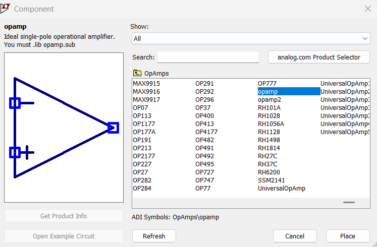
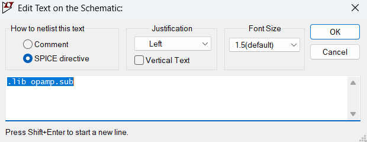

[← Back to overview](README.md)

# Problem 1. Basic OpAmp Built-up

## Tutorial
All Op-Amp circuits in our ELE 231 course will be in the setting of **ideal op-amp with negative feedback.**

This tutorial shows you how to set up a simple voltage follower (also called as buffer amp) in LTSpice.

- [ ] For the component, select from **"Component -> OpAmps folder -> opamp"**, as shown in this pic.

- [ ] To make schematic look clean, put input source symbols aside, instead of directly connecting input source symbols to the op-amp. 
- [ ] To do this, use **Label Net**. Two pins with the same net label are electrically connected, even if no wire is drawn between them.
- [ ] You can also set net labels as **Input** or **Output** to make schematic easier to understand.

- [ ] To conduct simulatation, add this to **SPICE Directives**:  `.lib opamp.sub`

- [ ] Finally, perform DC operating points analysis **DC op pnt**.
- [ ] The final schematic looks like such:
      

---------

## Task

In LTSpice, build the same circuit with in the tutorial. But:

* Set the input voltage to be your **x** value on the [README page](README.md)
* Set the feedback resistance R1 to be your **y** value on the [README page](README.md)

> [!TIP]
> If you have difficulty, I attach an example schematic file in the GitHub folder, named "OpAmp Minimal Wiring.asc", [quick link->](OpAmp%20Minimal%20Wiring.asc)
>
> You can **download its raw file** from GitHub, then open the downloaded .asc with LTSpice.

-----

## :orange: Required in your homework answer

1. Include a screenshot of your circuit schematic.

2. Include a LTSpice report of the DC operating point analysis. (*direct paste the list result*)

3. Based on the analysis result, indicate what is the voltage at the output, what is the current thru the feedback resistor R1?

> [!NOTE]
> The LTSpice OpAmp model we used is very nearly ideal, but not perfectly ideal.
