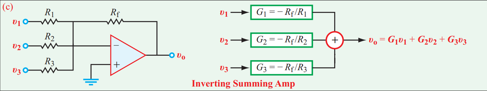

[← Back to overview](README.md)

# Problem 2. Summing Amp

---------

## Task

In LTSpice, build an Inverting Summing Amp with 3 voltage inputs. 

Follow the circuit diagram on the left side of this textbook figure:

* Set the input **$v_1$** to be your **x** value on the [README page](README.md)
* Set the input **$v_2$** to be your **y** value on the [README page](README.md)
* Set the input **$v_3$** to be 10 V
* $R_1=2$ Ω, $R_2=2$ Ω, $R_3=2$ Ω, $R_f=10$ Ω,
* Perform DC operating points analysis.

> [!NOTE]
> Follow the same LTSpice built-up approach in Problem 1.

-----

## :orange: Required in your homework answer

1. Include a screenshot of your circuit schematic.

2. Include a LTSpice report of the DC operating point analysis. (*direct paste the list result*)

3. Calculate the output voltage theoretically using the summing amp equation (listed in the figure above). 
  Compare with your LTSpice analysis result.
  Show calculation, not just final result.
