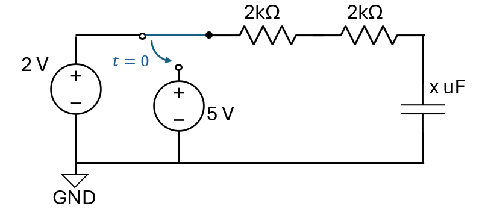
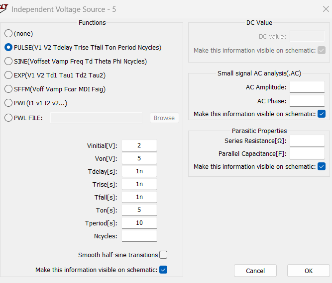

[← Back to overview](README.md)

# Problem 1. RC Response Circuit

## Task

In LTSpice, build this RC circuit.

Set the capacitance value $C$ = x uF, 

x value has been specified on the [README page](README.md)

--------

#### Note: Represent a Switch in LTspice
To represent such switch behavior, you can use **Advanced Voltage Source** in LTSpice.

In the regular voltage source symbol, you can click "Advanced" and lead you to a new Window. 

Configure it as such:
- PULSE
- Vinitial [V]: 2; Von[V]: 5
- Tdelay[s]: 1n; Trise[s]: 1n; Tfall[s]: 1n
- Ton[s]: 5; Tperiod[s]: 10

#### Note: Configure Analysis
Then, in the **Analysis**, configure such:
- Stop Time: use $10\tau$, where $\tau$ is your calculated Time Constant of this given circuit
- Time to start saving data: 0
- Maximum Timestep: 10u

-----

## :orange: Required in your homework answer

1. Include a screenshot of the plot of the current thru the voltage source, $I_x$.

2. Include a quick calculation of Equivalent Resistance $R_{eq}$ based on $R_{eq}=V_x/I_x$.

3. Include a detailed derivation and calculation of Equivalent Resistance $R_{eq}$ based on series-parallel reduction, like what you show in recitation worksheet. 

   *(You may write the calculation by hand, take a clear photo, and insert the photo into the same document.)*
