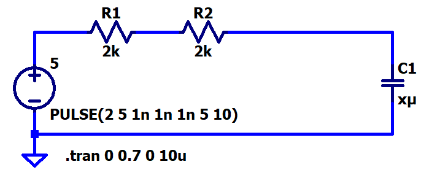

[← Back to overview](README.md)

# Problem 1. RC Response Circuit

## Task

In LTSpice, build this RC circuit.

Set the capacitance value $C$ = x uF, 

x value has been specified on the [README page](README.md)

--------

#### Note: Represent a Switch in LTspice
To represent such switch behavior, you can use **Advanced Voltage Source** in LTSpice.

In the regular voltage source symbol, you can click "Advanced" and lead you to a new Window. 

Configure it as such:
- PULSE
- Vinitial [V]: 2; Von[V]: 5
- Tdelay[s]: 1n; Trise[s]: 1n; Tfall[s]: 1n
- Ton[s]: 5; Tperiod[s]: 10

|  |   |
|---------------------|------------------------------|
| |  |

#### Note: Configure Analysis
Then, in the **Analysis**, configure such:
- Stop Time: use $10\tau$ (seconds), where $\tau$ is the theoretical Time Constant of this given circuit (from your calculation)
- Time to start saving data: 0
- Maximum Timestep: 10u

-----

## :orange: Required in your homework answer

1. Based on the given circuit, calculate these theoretical values: $v_c(0)$, $v_c(\infty)$, $\tau$. 

2. Derive the theoretical expression for $v_c(t)$ when $t\geq0$

3. Include a screenshot of your circuit schematic in LTSpice.

4. Include a screenshot of your source signal plot in LTSpice.

5. Include a screenshot of your $v_c(t)$ plot in LTSpice

