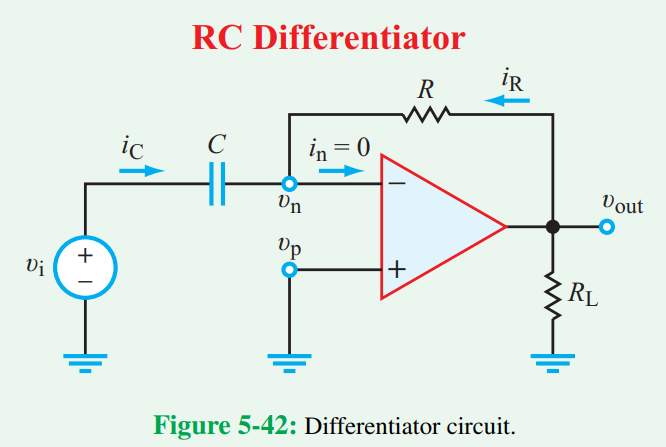
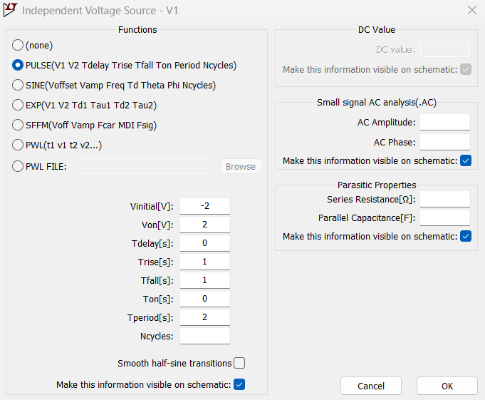
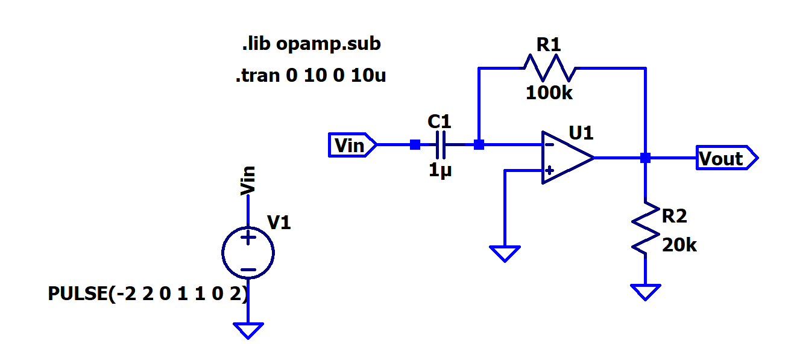

[← Back to overview](README.md)

# Problem 2. RC Op Amp

## Task

In LTSpice, build this RC circuit.

Set the capacitance value R = 100kΩ, C=1uF, RL=20kΩ

Input $v_i$ will be a periodic triangle signal, with the first period as:

$$v(t)= \begin{cases} -2+4t, & 0\le t<1\\\ 6-4t, & 1\le t<2 \end{cases}  $$

--------

#### Note in LTspice

- [ ] To set up such input, again you use the **Advanced Voltage Source**. Configure it as the picture showing.

- [ ] For Op Amp, continue to use the same ideal Op Amp in Chapter 4, [← Back to Chapter 4 review the setup](../Chapter%204%20Homework/Problem1_Basic%20OpAmp.md)

- [ ] Don't forget the **SPICE Directives** for the Op Amp:  `.lib opamp.sub`
  
- [ ] In the **Analysis**, set as: Stop Time: 10s; Time to start saving data: 0; Maximum Timestep: 10u

|  |   |
|---------------------|------------------------------|
| |  |

-----

## :orange: Required in your homework answer

1. Derive the theoretical output voltage for the first period.

  $$v_{o}(t)= \begin{cases} ???, & 0\le t<1\\\ ???, & 1\le t<2 \end{cases}  $$
  
2. Include a screenshot of your circuit schematic.

3. Include a screenshot with both Input $v_i(t)$ and Output $v_o(t)$ plots in the same figure.

