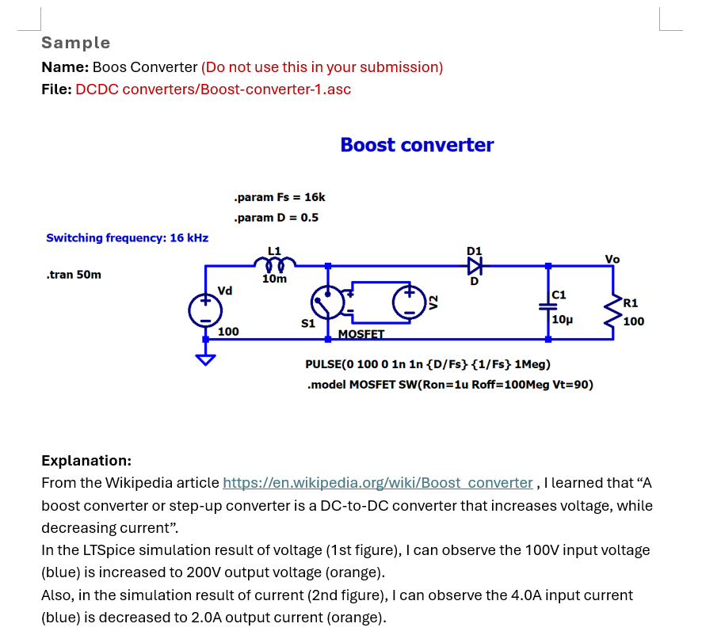
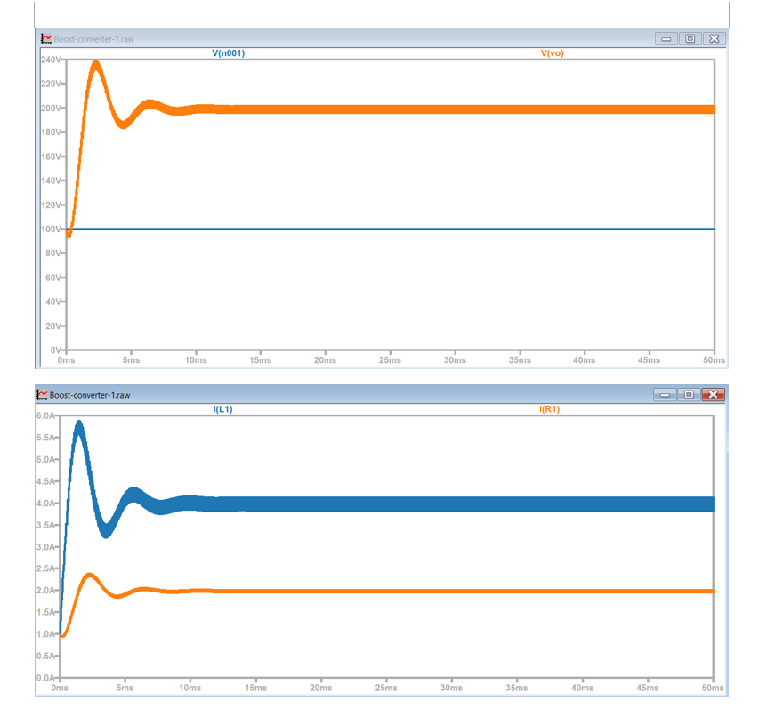

[← Back to overview](README.md)

# Problem 3. Free Exploration

## Task

Explore an LTspice circuit from this GitHub repository:

[https://github.com/mick001/Circuits-LTSpice/tree/master](https://github.com/mick001/Circuits-LTSpice/tree/master)

This repository contains a lot of LTspice circuits for various applications.

1. **Choose one circuit** from the repository. Download its LTspice schematic file (`.asc`) and open it in LTspice.
2. **Run the simulation** and explore how the circuit works. You can click different node voltages or component currents to observe their plots. 
3. **Understand the circuit.** Many circuits include some comments aside that breifly explains. You can also search online to learn what the circuit is used for and how it works.

*Note: You are not expected to fully understand every part of the circuit.*

---

## :orange: Required in Your Homework Answer

1. Indicate which circuit you selected, including its `.asc` filename, a screenshot of circuit schamtic.
2. Write at least **3 sentences** explaining what the circuit is used for and what you learned from exploring it. Your explanation should refer to the simulation results you obtained.
3. Include LTspice plot(s) that support your explanation in Item 2. 

*Here is an example (but don't use this circuit in your submission)*
|  |   |
|---------------------|------------------------------|
| |  |
