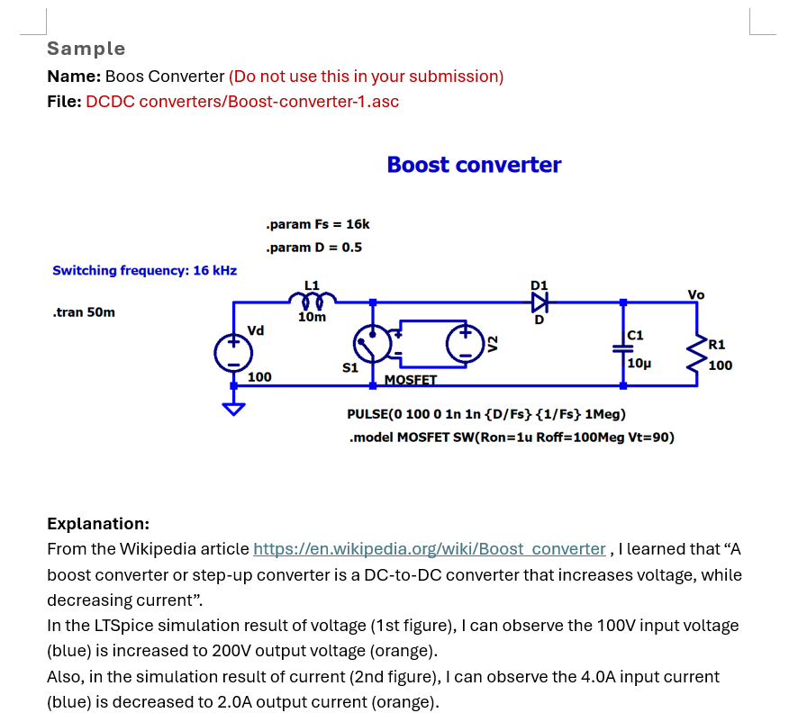
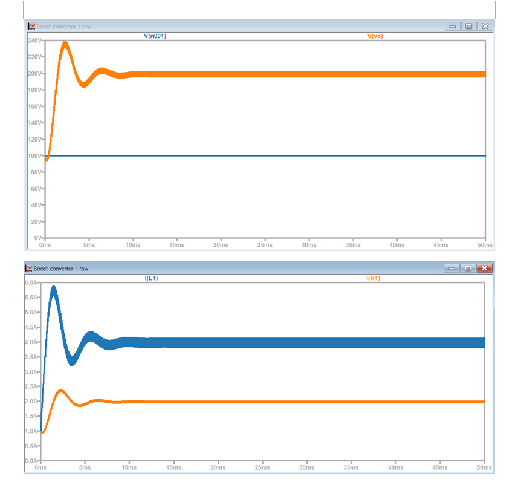

[← Back to overview](README.md)

# Problem 4. Free Exploration

## Task

The requirement of Problem 4 is the same as Problem 3.

Now, you need to pick **a different circuit from a different folder.**

---

## :orange: Required in Your Homework Answer

1. Indicate which circuit you selected, including its `.asc` filename, a screenshot of circuit schematic.
2. Write at least **3 sentences** explaining what the circuit is used for and what you learned from exploring it. Your explanation should refer to the simulation results you obtained.
3. Include LTspice plot(s) that support your explanation in Item 2. 

*Here is an example (but don't use this circuit in your submission)*
|  |   |
|---------------------|------------------------------|
| |  |
